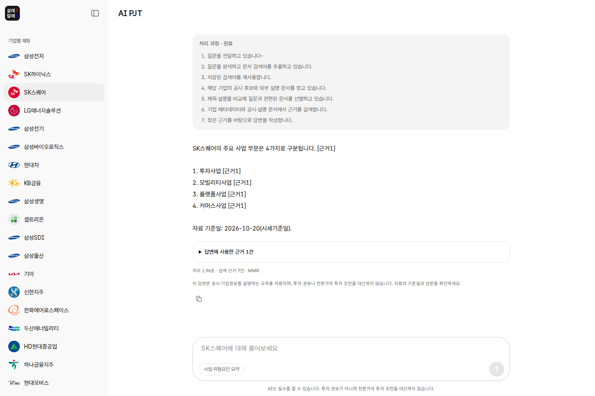
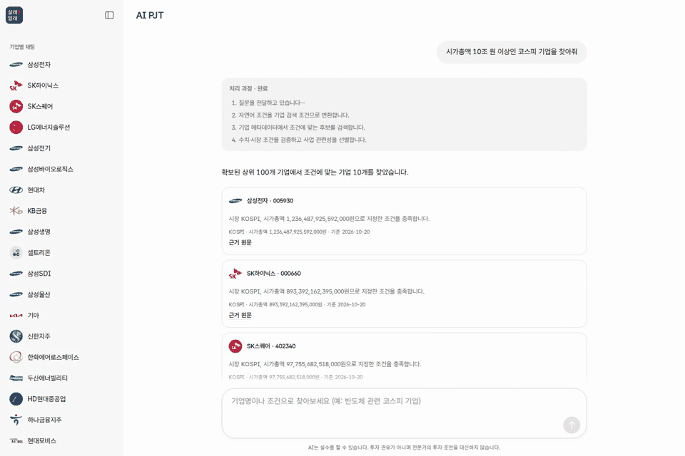
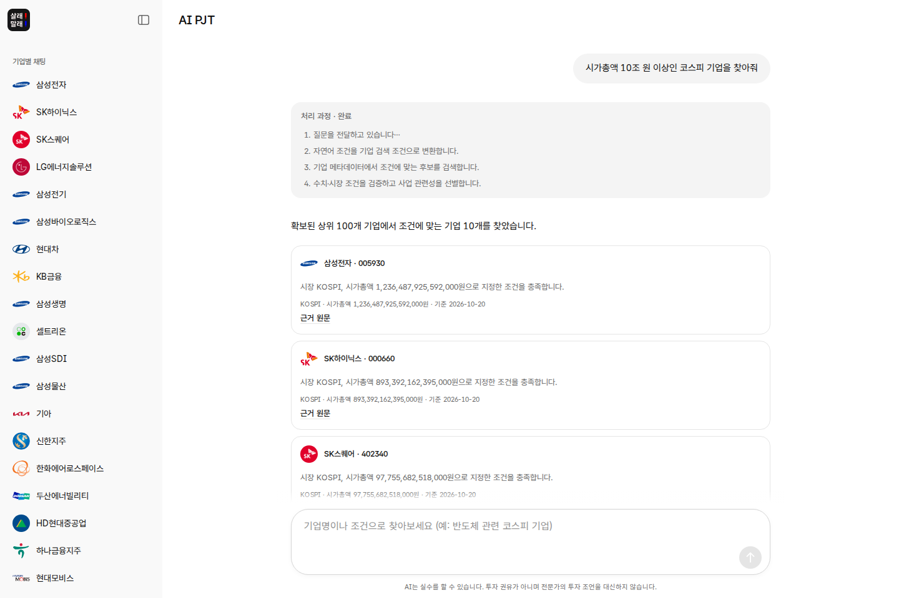
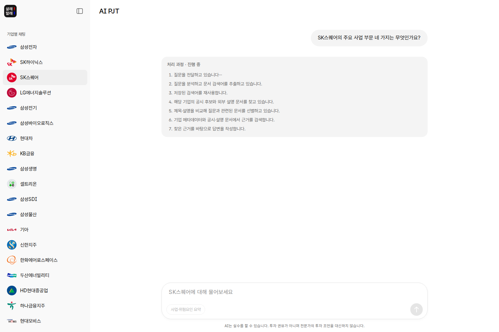
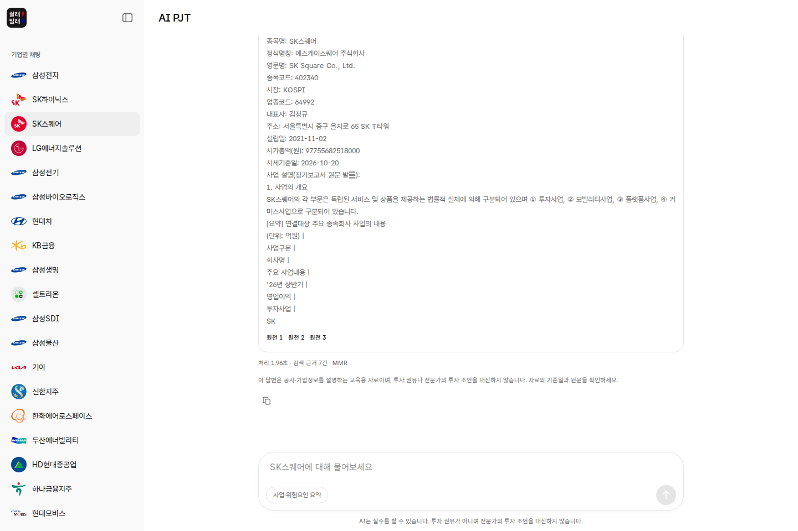
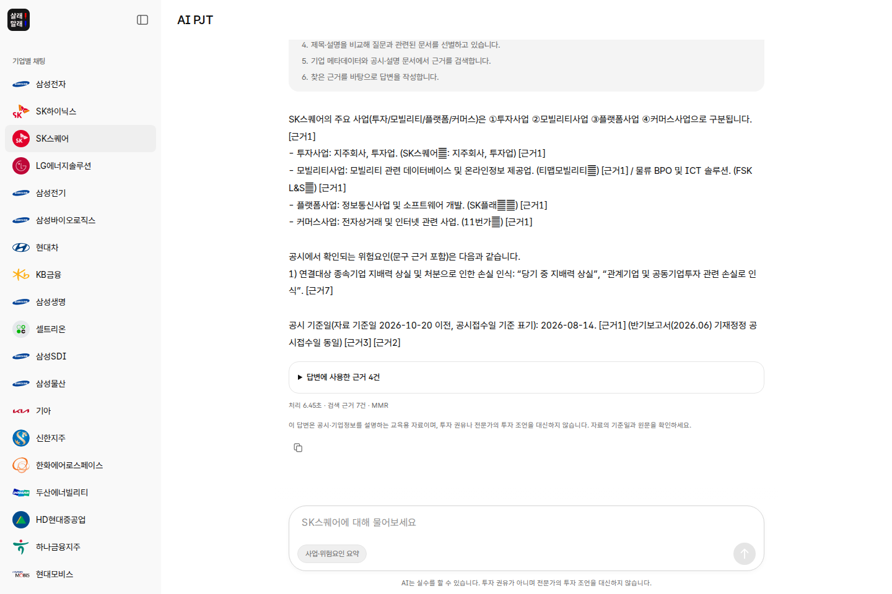
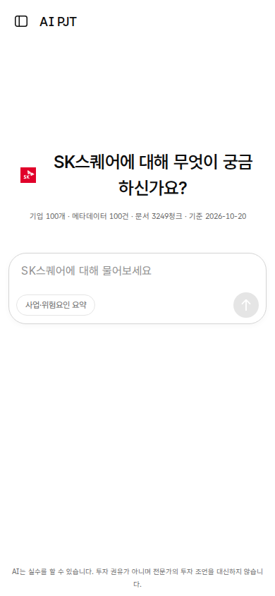
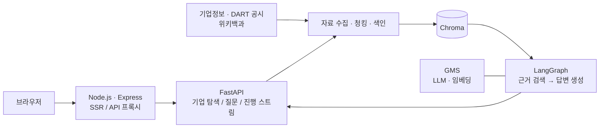

<div align="center">

# 살래말래 · Sell or Not

[](https://github.com/jihyukboin/ssafy-ai-core-project/actions/workflows/ci.yml)
[](LICENSE)
[](#시작하기)
[](#시작하기)

### 투자하기 전, 기업에 먼저 물어보세요.

국내 시가총액 상위 100개 기업을 탐색하고,<br />
공시와 기업정보를 근거로 사업과 위험요인을 확인하는 AI 리서치 서비스입니다.

`JavaScript` · `Tailwind CSS` · `SSR` · `FastAPI` · `LangGraph` · `Chroma`

[시연 영상](#시연-영상) · [서비스 화면](#서비스-화면) · [시작하기](#시작하기) · [기술 구성](#기술-구성) · [기여하기](CONTRIBUTING.md)

</div>

<br />



## 시연 영상

[](docs/media/demo.webm)

**[▶ 전체 시연 영상 보기 · WebM](docs/media/demo.webm)**

자연어로 기업 찾기 → 기업 선택 → 질문하기 → 처리 과정 확인 → 답변의 근거 펼치기 → 사업·위험요인 요약까지, 실제 실행 중인 서비스를 촬영했습니다. 위 미리보기는 같은 영상의 일부 구간입니다.

## 살래말래에서 할 수 있는 일

1. **조건으로 기업 찾기** — “시가총액 10조 원 이상인 코스피 기업”처럼 원하는 조건을 입력하고 결과 카드에서 기업을 선택합니다.
2. **기업에 대해 질문하기** — 사업 부문, 주요 제품, 공시에 담긴 수치 등을 자연어로 질문합니다. 선택한 기업의 자료에서 관련 근거를 검색합니다.
3. **답변의 출처 확인하기** — 답변의 `[근거 N]`과 연결된 문서 제목, 기준일, 본문 발췌와 원문 링크를 함께 확인합니다.
4. **사업과 위험요인 요약하기** — 기업 화면의 `사업·위험요인 요약` 버튼으로 공시에서 확인되는 내용을 정리합니다.

## 서비스 화면

### 기업을 찾고 질문하기

| 기업 탐색 | 공시 기반 질의응답 |
| :---: | :---: |
|  |  |
| 시장·시가총액·사업 조건으로 기업을 찾고, 카드를 눌러 질문을 이어갑니다. | 기업별 화면에서 질문하고 인용 번호가 포함된 답변을 받습니다. |

### 답변이 만들어지는 과정 확인하기

| 처리 과정 | 원문과 근거 |
| :---: | :---: |
|  |  |
| 검색어 추출부터 수집·선별·색인·검색·생성까지 진행 내역을 확인합니다. | 답변에 사용된 근거를 펼쳐 출처와 발췌를 읽고 원문으로 이동합니다. |

### 한 번 더 살펴보기

| 사업·위험요인 요약 | 모바일 |
| :---: | :---: |
|  |  |
| 선택 기업의 사업 개요와 확인되는 위험요인을 함께 정리합니다. | 작은 화면에서도 기업별 질문을 시작할 수 있습니다. |

> 화면과 영상은 로컬 데이터와 실제 API 응답으로 촬영했습니다. 데이터 기준일과 모델 응답에 따라 표시 내용과 처리 시간이 달라질 수 있습니다.

## 주요 기능

| 기능 | 설명 |
| --- | --- |
| 기업별 리서치 | 시가총액 상위 100개 기업 목록, 기업 로고, 종목코드별 URL |
| 자연어 탐색 | 시장·시가총액·기업명·사업 조건으로 후보를 찾고 기업 화면으로 이동 |
| 근거 기반 답변 | 기업 메타데이터·DART 공시·위키백과에서 검색한 자료로 답변 생성 |
| 출처 확인 | 실제 인용한 문서의 제목·유형·기준일·발췌·원문 링크 제공 |
| 사업·위험요인 요약 | 선택 기업의 사업과 위험요인을 동일한 RAG 파이프라인으로 정리 |
| 진행 상태 | 질문별 처리 단계를 스트림으로 수신하고 완료 후에도 내역 표시 |
| 검색 설정 | MMR·유사도 검색, 청크 크기·중복 길이·Top-k 조정 |
| 페이지 내 대화 | 기업별로 질문을 이어가며, 새로고침 시 대화 초기화 |

필수 기능(F2001~F2012)은 데이터 적재·색인, 문서 수집, 근거 기반 질의응답, 기업별 대화, 사업·위험요인 요약, 조건 탐색과 진행·오류 안내입니다. 선택 심화 기능(F2013~F2016)은 HTML/CSS/JavaScript 화면 직접 구현, MMR 검색, RAG 전후 품질 비교, DART·위키백과 복수 출처 결합입니다.

자료에서 확인되지 않는 내용은 확인할 수 없다고 답하도록 구성했습니다. 현재 시세나 모든 최신 공시를 실시간으로 보장하지 않으며, 시세 기준일과 공시 기간을 구분해 확인해야 합니다. 서비스의 답변은 투자 권유가 아니며 전문가의 투자 조언을 대신하지 않습니다.

## 기술 구성



| 영역 | 사용 기술 |
| --- | --- |
| 화면 | HTML · JavaScript · Tailwind CSS · Pretendard GOV |
| 프런트엔드 서버 | Node.js · Express · Vite SSR |
| API 서버 | Python · FastAPI · Uvicorn |
| RAG | LangChain · LangGraph · Chroma · MMR |
| 모델 | GMS `gpt-5.4-nano` · `text-embedding-3-small` |
| 데이터 | 금융위원회 주식시세정보 · OpenDART · 한국어 위키백과 |

브라우저는 프런트엔드의 `/api`를 호출하고, 프런트엔드 서버가 백엔드로 요청을 전달합니다. API 키는 백엔드에서만 사용합니다. 기업 메타데이터를 먼저 색인하고, 질문에 필요한 공시와 설명 문서를 추가로 색인해 재사용합니다. 대화는 페이지 메모리에만 유지하며 서버에 대화·생성 답변을 파일로 저장하지 않습니다.

## 시작하기

### 1. 준비 사항

- Python 3.10 이상
- Node.js 20.19 이상 또는 22.12 이상
- GMS API 키
- 데이터 최초 수집용 OpenDART·공공데이터포털 API 키
- 위키백과 요청 식별에 사용할 이메일 또는 프로젝트 연락 URL

아래 명령은 별도 안내가 없으면 프로젝트 루트에서 실행합니다.

### 2. 설치와 환경변수

```bash
python3 -m venv backend/.venv
backend/.venv/bin/python -m pip install -r backend/requirements.txt
backend/.venv/bin/python -m pip install -r scripts/requirements-dataset.txt
cp backend/.env.example backend/.env

cd frontend
npm ci
cd ..
```

`backend/.env`에 다음 값을 입력합니다.

```dotenv
GMS_KEY=your_gms_key
WIKI_CONTACT=your_email_or_project_url
OPENDART_API_KEY=your_opendart_key
DATA_GO_KR_API_KEY=your_data_go_kr_key
```

### 3. 데이터 준비와 색인

```bash
# 예시 기준일의 기업·시세·공시 수집
backend/.venv/bin/python scripts/build_stock_dataset.py --as-of 2026-10-20
backend/.venv/bin/python scripts/validate_stock_dataset.py

# 기업 메타데이터 색인
cd backend
.venv/bin/python -m rag.index
cd ..
```

`data/kr_stocks/latest.json`과 해당 스냅샷이 이미 있으면 수집을 생략할 수 있습니다. 처음 질문하는 기업은 문서 수집과 색인에 시간이 더 걸릴 수 있습니다. 수집 데이터와 기업 로고는 저장소에 포함하지 않습니다. 출처와 이용 조건은 [데이터 안내](data/kr_stocks/README.md)를 확인하세요.

### 4. 실행

서로 다른 터미널에서 백엔드와 프런트엔드를 실행합니다.

```bash
# 터미널 1 · 프로젝트 루트
backend/.venv/bin/python -m uvicorn app:app --app-dir backend --host 0.0.0.0 --port 3001
```

```bash
# 터미널 2 · 프로젝트 루트
cd frontend
npm run dev
```

| 주소 | 용도 |
| --- | --- |
| <http://localhost:3000> | 서비스 화면 |
| <http://localhost:3001/docs> | API 문서 |

<details>
<summary>배포 빌드와 색인 설정</summary>

프런트엔드는 SSR 방식이므로 배포할 때도 Node.js 서버와 백엔드가 필요합니다.

```bash
cd frontend
npm run build
npm start
```

`backend/rag_config.json`에서 모델, 청크 크기, 중복 길이, Top-k, MMR·유사도 검색 방식을 조정할 수 있습니다. 청킹·임베딩 설정을 변경하면 색인을 다시 구축합니다.

```bash
cd backend
.venv/bin/python -m rag.index --rebuild

# 특정 기업의 정기보고서를 미리 색인
.venv/bin/python -m rag.index --company 402340
```

</details>

## 프로젝트 구조

```text
backend/
  app.py                 기업·상태 API와 답변 스트림
  rag/                   수집·청킹·색인·검색·답변 생성
  rag_config.json        모델과 검색 설정
  tests/                 RAG·API 테스트
frontend/
  server.js              SSR 서버와 백엔드 프록시
  src/components/        기업 목록·대화·근거 화면
  src/features/          기업 선택과 질문 흐름
  src/services/          스트림 API 클라이언트
scripts/                 데이터 수집·검증·RAG 응답 비교
docs/                    기능명세·설계·검증·시연 자료
```

## 테스트와 응답 비교

```bash
# 프로젝트 루트
PYTHONPATH=.:backend backend/.venv/bin/python -m unittest discover -s backend/tests -v

cd frontend
npm test
npm run build
```

대표 질문 5개에 대한 일반 LLM·RAG 응답과 유사도·MMR 검색 결과를 [RAG 품질 비교](docs/검증/RAG_품질비교.md)에 기록했습니다. 수치·사업 부문·기준일·근거 제시와 자료에 없는 질문의 응답을 원문과 함께 비교할 수 있습니다.

백엔드를 실행한 상태에서 다음 명령으로 비교를 다시 수행할 수 있습니다. 실제 GMS 모델을 호출하므로 API 사용 비용이 발생합니다.

```bash
PYTHONPATH=.:backend backend/.venv/bin/python scripts/evaluate_rag.py
```

## 문서

- [기능명세서](docs/기능명세서/1.md) — 화면·API·서비스 요구사항
- [RAG 파이프라인](docs/RAG_파이프라인.md) — 수집·색인·검색·근거 처리 설계
- [RAG 품질 비교](docs/검증/RAG_품질비교.md) — 실제 질문과 응답, 검색 방식 비교
- [요구사항 검증 결과](docs/검증/요구사항_검증결과.md) — 전체 요구사항 대조·보완 내역·테스트 결과·셀프/상호 체크리스트
- [데이터 안내](data/kr_stocks/README.md) — 수집 방법·출처·이용 조건
- [백엔드 안내](backend/README.md) · [프런트엔드 안내](frontend/README.md)

## 기여하기

버그 수정, 문서 개선, 기능 제안을 환영합니다. 시작 방법과 검증 절차는 [기여 안내](CONTRIBUTING.md)를 참고하세요.

- [버그 제보](https://github.com/jihyukboin/ssafy-ai-core-project/issues/new?template=bug_report.yml)
- [기능 제안](https://github.com/jihyukboin/ssafy-ai-core-project/issues/new?template=feature_request.yml)

## 라이선스와 출처

프로젝트의 자체 작성 코드와 문서는 [MIT 라이선스](LICENSE)로 공개합니다. 외부 이미지·로고·폰트·데이터에는 각 권리자의 이용 조건이 적용됩니다.

- 기업정보·시세·공시와 위키백과: [데이터 출처 및 이용 조건](data/kr_stocks/README.md)
- 서비스 아이콘: [프런트엔드의 출처 안내](frontend/README.md)
- Pretendard GOV: [폰트 라이선스](frontend/public/fonts/pretendard-gov/LICENSE.txt)

스크린샷과 영상에 포함된 제3자 자료의 권리는 각 권리자에게 있습니다.
