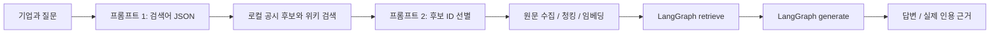

# RAG 파이프라인 설계

## 처리 흐름

그래프는 `START → retrieve → generate → END` 두 노드다. 검색어 추출과 수집·색인은 그래프 실행 전에 진행하고, 실제 그래프 노드가 순서대로 근거 검색·생성을 수행한다. 체크포인터·로그인·대화 파일 저장은 사용하지 않는다.

## 두 컬렉션

| 컬렉션 | 단위와 ID | 메타데이터 |
|---|---|---|
| `stock_meta` | 기업당 텍스트 1개, ID=종목코드 | 기업명, 종목코드, 시장, 시가총액, 시세 기준일, 원문 URL들, 내용 해시 |
| `disclosure_docs` | 공시·위키 본문의 청크. ID=`종목코드:문서ID:설정해시:내용해시:순번` | 종목코드, 제목, 원문 URL, 출처 유형, 공시접수일 또는 수집일, 문서ID, 청크순번 |

문서가 여러 기업에 연결돼도 종목코드가 다르므로 덮어쓰지 않는다. 임베딩은 GMS `text-embedding-3-small`을 사용한다. 동일 기업 텍스트·동일 청크가 이미 있으면 임베딩 API를 다시 호출하지 않는다. 메타데이터는 최신 출처 정보로 갱신한다.

## 원문 확보와 캐시

기업 100개 메타데이터는 CLI로 먼저 색인한다. 공시 전체는 이미 로컬에 수집되어 있으며, 질문마다 그 기업의 다운로드 완료 공시를 후보로 사용한다. 위키백과에서는 검색어로 후보 제목·설명을 얻는다. 프롬프트 2가 선택한 문서의 본문만 가져오고, 기업의 자체 정기보고서는 제외·길이 규칙보다 우선하여 **전체 본문**을 항상 색인한다. 정확한 기업명의 위키 설명 문서는 배경 자료로 함께 포함한다.

`.rag/cache/`는 검색어 추출 결과, 후보 선택 ID, 위키 검색 결과·원문을 저장한다. 캐시 키는 입력의 SHA-256이고 전체 대화·답변·키·프롬프트는 저장하지 않는다. 공시 원문은 `data/kr_stocks`를 재사용한다. 위키백과 요청은 식별 가능한 연락처, 0.4초 호출 간격, 429/일시 오류에 최대 3회 시도를 적용한다. 위키 연결이 실패하면 상태를 알리고 확보된 공시로 계속 처리한다.

## 프롬프트 3종

1. **검색어 추출:** 국내 기업 조사 전문가 역할. 기업명·질문·현재 요청의 최근 문맥으로 `standalone_question`, `queries` JSON을 만든다. 기업명은 코드에서도 강제로 포함한다. 단일 질문에서는 원래 질문을 그대로 검색·생성에 사용하여 질문 범위 확장을 막는다.
2. **후보 선별:** 기업·질문·후보 ID/제목/설명으로 `selected_ids` JSON을 만든다. 후보에 없는 ID는 버리고 추가 문서 수를 제한한다. 자체 정기보고서는 별도 강제 포함이다.
3. **답변 생성:** 제공된 근거만 사용하고 주요 주장 뒤에 `[근거 N]`을 붙인다. 확인되지 않는 사실·미래 수치·투자 권유는 생성하지 않도록 제약한다. 공시 접수일·재무 기간·시세 기준일, 연결/별도·자회사·금액 단위를 구분한다.

JSON은 Pydantic 스키마로 검증하며 형식 실패 시 한 번 형식 교정을 요청한다. 데이터·문서 안의 역할 변경 지시는 따르지 않도록 명시한다.

## 청킹과 검색 설정

기본 청크 1,200자·중복 200자, 외부 근거 Top-k=6, 후보 fetch-k=24, MMR λ=0.65다. 문단·행을 먼저 나누어 공시 표와 설명의 문맥을 가능한 한 유지하고, 길면 문자 단위로 분할한다. 메타데이터는 항목당 1개를 유지한다. 값은 `backend/rag_config.json`에서 바꾼다.

선택 기업의 메타데이터를 항상 첫 근거로 넣고, 외부 컬렉션은 `stock_code`로 범위를 제한한다. cosine 유사도 검색의 후보에 MMR을 적용해 비슷한 청크만 모이는 것을 줄인다. 본문 SHA-256으로 완전히 동일한 청크를 제거하고 두 종류 근거를 합친다. MMR/유사도 결과 ID 차이는 실제 품질 비교 문서에 기록했다. 청크 크기 변경에 따른 건수 변화는 단위 테스트에서 검증한다.

## 근거와 UI

답변에서 번호를 파싱하여 실제 검색 결과 안에 있는 번호만 추린다. 화면에는 **실제로 인용된 근거만** 원래 번호로 표시한다. 각 근거는 제목·원문 링크·출처 유형·기준일·발췌를 제공하며 기업 메타데이터는 원천 URL들도 제공한다. 인용이 없으면 그 사실을 안내한다. 프롬프트 전문이나 API 키를 응답에 넣지 않는다.

프런트엔드는 NDJSON 상태 이벤트를 소비한다. 질문을 보내면 검색어 추출 → 수집 → 선별 → 필요한 청크 색인 → 검색 → 답변 생성을 보여준다. 기업을 바꾸면 진행 중인 브라우저 요청을 취소하고 이전 요청이 다른 기업 화면을 덮어쓰지 못하게 한다.

## 서비스 기능

- **사업·위험요인 요약:** 선택 기업의 사업 개요와 확인되는 위험요인을 동일 RAG에 질문하며 근거를 함께 표시한다.
- **자연어 탐색:** 자연어를 시장·시가총액·기업명·사업 조건으로 나누고 수치·시장은 실제 데이터로 검증한다. 메타데이터 의미 검색 및 시총 상위 후보를 LLM이 선별한다. 반환 코드는 후보·조건을 통과한 실제 기업으로 다시 제한한다. 카드를 선택하면 그 기업 URL·채팅으로 이동한다.

## 확인한 문제와 해결

- 일부 사업 설명이 보고서 목차에서 끝나는 문제: 후보 위치를 순회하고 한국어 본문이 충분한 구간만 원문 발췌하도록 수정했다. 100개 기업을 재생성하고 해시·발췌 위치를 다시 검증했다.
- 선택 조건이 없을 때 모델이 배열에 null을 반환하는 문제: 선택적 조건 배열의 null을 명시적으로 허용했다.
- 초기 대화·아이콘 주입으로 인한 화면 이동: 대화 영구 저장을 제거하고 서버가 기업 목록·선택 제목·아이콘·도구·준비 상태를 초기 HTML에 포함한다. CSS는 렌더링을 차단하는 링크로 제공하고 폰트 서브셋만 선행 로딩한다.
